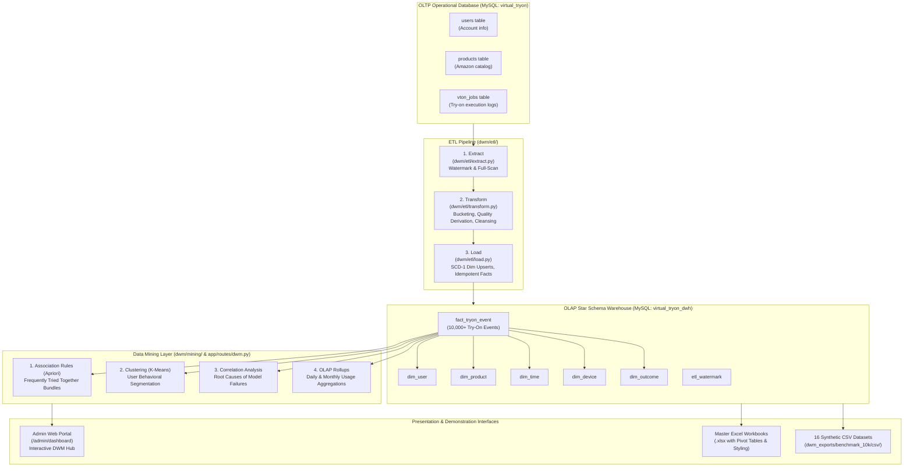

# Data Warehousing & Data Mining (DWM) — Complete Architecture & Reference Guide

Welcome to the comprehensive documentation of the **Data Warehousing & Data Mining (DWM)** subsystem for the **AI Virtual Try-On** platform.

This document covers everything about the analytical architecture: the **Star Schema OLAP Warehouse**, the **ETL Pipeline**, all **4 Core Data Mining Techniques**, the **Interactive Admin DWM Dashboard**, and the **10,000-entry Synthetic Datasets & Excel Workbooks**.

---

## 📑 Table of Contents

1. [Executive Summary & Motivation](#1-executive-summary--motivation)
2. [End-to-End System Architecture](#2-end-to-end-system-architecture)
3. [OLAP Data Warehouse Star Schema](#3-olap-data-warehouse-star-schema)
   - [Fact Table: `fact_tryon_event`](#fact-table-fact_tryon_event)
   - [Dimension Tables (`dim_user`, `dim_product`, `dim_time`, `dim_device`, `dim_outcome`)](#dimension-tables)
   - [Database Setup & Connection Details](#database-setup--connection-details)
4. [ETL Pipeline (Extract, Transform, Load)](#4-etl-pipeline-extract-transform-load)
   - [Extraction (Full Scan vs. Watermark Delta)](#step-1-extract)
   - [Transformation (Data Cleansing & Bucketing)](#step-2-transform)
   - [Loading (SCD-1 Upserts & Idempotency)](#step-3-load)
5. [The Core Data Mining & OLAP Techniques](#5-the-core-data-mining--olap-techniques)
   - [Technique 1: Association Rule Mining (Apriori)](#technique-1-association-rule-mining-apriori)
   - [Technique 2: User Segmentation Clustering (K-Means)](#technique-2-user-segmentation-clustering-k-means)
   - [Technique 3: Model Failure & Quality Correlation Analysis](#technique-3-model-failure--quality-correlation-analysis)
   - [Technique 4: OLAP Time-Series Rollups (Daily & Monthly)](#technique-4-olap-time-series-rollups-daily--monthly)
   - [Technique 5: Multidimensional OLAP Operations (Drill-Down, Roll-Up, Slice & Dice)](#technique-5-multidimensional-olap-operations-drill-down-roll-up-slice--dice)
6. [Interactive Admin DWM Dashboard](#6-interactive-admin-dwm-dashboard)
   - [UI Overview & KPI Header](#ui-overview--kpi-header)
   - [Tab 1: Tabular Apriori Outfit Pairings](#1-frequently-tried-together-apriori)
   - [Tab 2: Interactive Scatter & Donut Behavioral Visualizers](#2-user-segmentation-k-means)
   - [Enterprise 5-Color Behavioral Palette](#enterprise-5-color-behavioral-palette)
   - [Tab 3: Failure & Quality Correlation Analytics](#3-failure--quality-correlations)
   - [Tab 4: Pre-Aggregated OLAP Time-Series Rollups](#4-olap-usage-rollups)
   - [Tab 5: Timeline Deep Dive (Drill-Down)](#5-timeline-deep-dive-olap-drill-down)
   - [Tab 6: Period Summaries (Roll-Up)](#6-period-summaries-olap-roll-up)
   - [Tab 7: Filter by Feature (Slice)](#7-filter-by-feature-olap-slice)
   - [Tab 8: Multi-Filter Search (Dice)](#8-multi-filter-search-olap-dice)
   - [Dual-Engine Data Processing Architecture](#dual-engine-data-processing-architecture)
   - [Backend REST API Endpoints](#backend-rest-api-endpoints)
7. [Datasets & Excel Export Master Files](#7-datasets--excel-export-master-files)
   - [Master Multi-Sheet Excel Workbooks](#master-multi-sheet-excel-workbooks)
   - [10,000 Record Synthetic CSV Files](#10000-record-synthetic-csv-files)
   - [Demonstrating with Pivot Tables & Slicers](#demonstrating-with-pivot-tables--slicers)
8. [How to Run, Test, and Evaluate](#8-how-to-run-test-and-evaluate)
   - [Native Windows Web Launcher](#launching-the-web-application)
   - [Admin Portal Login Credentials](#admin-portal-login-credentials)
   - [End-to-End Smoke Test Suite (22 Automated Tests)](#end-to-end-smoke-test-suite)
   - [Standalone Python CLI Commands](#standalone-cli-commands)
   - [Frontend Production Build Validation](#frontend-production-build-validation)

---

## 1. Executive Summary & Motivation

In an AI-powered e-commerce environment (such as Virtual Try-On using diffusion models like CatVTON), the transactional database (OLTP) is optimized for single-row inserts and high-concurrency operations (logging user requests, saving generated looks, updating carts).

However, OLTP is **not designed for analytical queries** such as:
- *"Which garments are frequently tried together so we can bundle them?"*
- *"What behavioral clusters exist among our shoppers (VIPs vs. trial users)?"*
- *"Why does the AI diffusion model fail on mobile camera uploads or shiny silk fabrics?"*
- *"How is system load, success rate, and latency trending day-by-day and month-by-month?"*

The **DWM subsystem** solves this by decoupling operational processing from analytical intelligence:
1. **OLAP Star Schema**: Stores denormalized dimensions around a central measure fact table.
2. **ETL Pipeline**: Cleans, deduplicates, buckets, and loads OLTP data into the warehouse.
3. **Data Mining Engines**: Implements 4 algorithms to extract actionable retail and operational insights.
4. **Interactive Dashboard**: Gives admins real-time control to filter, re-mine, and visualize results directly in the browser.

---

## 2. End-to-End System Architecture



---

## 3. OLAP Data Warehouse Star Schema

The analytical warehouse database (`virtual_tryon_dwh`) is structured as a dimensional **Star Schema**, optimized for OLAP aggregations, slice-and-dice queries, and BI reporting.

```
       +-----------------------+              +-----------------------+
       |       dim_user        |              |      dim_product      |
       +-----------------------+              +-----------------------+
       | PK user_key           |              | PK product_key        |
       |    user_id (natural)  |              |    product_id (ASIN)  |
       |    signup_date        |              |    category           |
       |    total_tryons       |              |    color              |
       |    engagement_level   |              |    pattern            |
       +-----------+-----------+              |    price_bracket      |
                   |                          +-----------+-----------+
                   |                                      |
                   |         +-------------------+        |
                   +-------->| fact_tryon_event  |<-------+
                             +-------------------+
                             | PK tryon_id       |
                             | UQ job_id         |
                   +-------->| FK user_key       |<-------+
                   |         | FK product_key    |        |
                   |         | FK time_key       |        |
                   |         | FK device_key     |        |
                   |         | FK outcome_key    |        |
                   |         | processing_time_ms|        |
                   |         | quality_score     |        |
                   |         | user_rating       |        |
                   |         | retry_count       |        |
                   |         | saved_after_tryon |        |
                   |         +-------------------+        |
                   |                                      |
       +-----------+-----------+              +-----------+-----------+
       |      dim_device       |              |       dim_time        |
       +-----------------------+              +-----------------------+
       | PK device_key         |              | PK time_key (YYYYMMDD)|
       |    device_type        |              |    full_timestamp     |
       |    upload_method      |              |    hour, day, week    |
       +-----------------------+              |    month, year        |
                                              |    weekday_or_weekend |
                   +-----------------------+  +-----------------------+
                   |      dim_outcome      |
                   +-----------------------+
                   | PK outcome_key        |
                   |    success_or_fail    |
                   |    failure_reason     |
                   +-----------------------+
```

### Fact Table: `fact_tryon_event`
- **Grain**: Exactly one row per virtual try-on attempt.
- **Attributes & Measures**:
  - `tryon_id` (`BIGINT`, PK, Auto-increment): Surrogate key for warehouse rows.
  - `job_id` (`BIGINT`, Unique Index): Natural key from OLTP `vton_jobs.id`, guaranteeing idempotency during repeated ETL runs.
  - `user_key` (`BIGINT`, FK → `dim_user.user_key`).
  - `product_key` (`BIGINT`, FK → `dim_product.product_key`).
  - `time_key` (`BIGINT`, FK → `dim_time.time_key`).
  - `device_key` (`BIGINT`, FK → `dim_device.device_key`).
  - `outcome_key` (`BIGINT`, FK → `dim_outcome.outcome_key`).
  - `processing_time_ms` (`INT`): End-to-end execution latency in milliseconds.
  - `quality_score` (`DECIMAL(4,2)`): Evaluated visual fidelity of the synthesized image ($0.00$ to $1.00$).
  - `user_rating` (`INT`): Explicit customer feedback rating ($1$ to $5$ stars, nullable).
  - `retry_count` (`INT`): How many times the user re-submitted before success.
  - `saved_after_tryon` (`BOOLEAN`): Whether the garment was saved to wishlists or purchased.

### Dimension Tables

#### 1. `dim_user` (Slowly Changing Dimension Type 1)
- `user_key` (PK): Surrogate warehouse user identifier.
- `user_id` (Unique Natural Key): Points to `users.id` in the transactional DB.
- `signup_date` (`DATE`): Customer onboarding date.
- `total_tryons` (`INT`): Lifetime cumulative try-on count.
- `engagement_level` (`VARCHAR`): Derived classification bucket:
  - *Inactive* ($0$ try-ons)
  - *Low* ($1 - 2$ try-ons)
  - *Medium* ($3 - 10$ try-ons)
  - *High* ($11 - 25$ try-ons)
  - *Power User* ($> 25$ try-ons)

#### 2. `dim_product`
- `product_key` (PK): Surrogate product identifier.
- `product_id` (Unique Natural Key): Points to `products.id`.
- `amazon_product_id` (`VARCHAR`): Amazon ASIN code (e.g., `B08N5WRWNW`).
- `category` (`VARCHAR`): Apparel category (*T-Shirt*, *Shirt*, *Jeans*, *Dress*, *Jacket*, *Hoodie*, *Blazer*, etc.).
- `color` (`VARCHAR`): Dominant color detected or tagged (*Black*, *Navy Blue*, *Crimson*, *Olive*, etc.).
- `pattern` (`VARCHAR`): Texture pattern (*Solid*, *Striped*, *Plaid*, *Graphic Print*, *Floral*).
- `price_bracket` (`VARCHAR`): Economic tier:
  - *Budget* ($< ₹500$)
  - *Mid-Range* ($₹500 - ₹2,000$)
  - *Premium* ($> ₹2,000$)

#### 3. `dim_time`
- `time_key` (`BIGINT`, PK): Hierarchical composite key formatted as `YYYYMMDDHH` (e.g., `2026100214` for 2:00 PM on Oct 2, 2026).
- `full_timestamp` (`DATETIME`): Exact timestamp.
- `hour` ($0 - 23$), `day` ($1 - 31$), `week` ($1 - 53$), `month` ($1 - 12$), `year` ($2025, 2026$).
- `weekday_or_weekend` (`VARCHAR`): Classification for behavioral weekend surge analysis.

#### 4. `dim_device`
- `device_key` (PK): Surrogate channel key.
- `device_type` (`VARCHAR`): Client hardware (*Mobile*, *Desktop*, *Tablet*).
- `upload_method` (`VARCHAR`): Method used to capture the user photo (*Camera*, *Gallery*, *URL*).

#### 5. `dim_outcome`
- `outcome_key` (PK): Surrogate result key.
- `success_or_fail` (`VARCHAR`): Binary status (*SUCCESS* vs. *FAILURE*).
- `failure_reason` (`VARCHAR`): Root cause taxonomy (*None*, *Model Inference Error*, *Face Occlusion*, *Low Resolution*, *Invalid Garment Mask*, *Network Timeout*).

### Database Setup & Connection Details
Warehouse models and connections are defined in [`dwm/connection.py`](dwm/connection.py) and [`dwm/models.py`](dwm/models.py):
- **OLTP DB**: `virtual_tryon` (Default port `3306`)
- **DWH DB**: `virtual_tryon_dwh` (Separate analytical database)
- **DDL Creation Script**: [`dwm/schema/star_schema.sql`](dwm/schema/star_schema.sql)

---

## 4. ETL Pipeline (Extract, Transform, Load)

The ETL pipeline resides in [`dwm/etl/`](dwm/etl/) and provides reliable, repeatable data ingestion from the transactional MySQL store into the Star Schema.

### Step 1: Extract ([`dwm/etl/extract.py`](dwm/etl/extract.py))
- **Incremental Extraction**: Reads the high-watermark timestamp stored in `etl_watermark` table. Only records where `created_at > last_watermark` are extracted.
- **Full Refresh Support**: Passing `--full-refresh` extracts the entire historical dataset from `vton_jobs`, `users`, and `products`.

### Step 2: Transform ([`dwm/etl/transform.py`](dwm/etl/transform.py))
- **Date & Time Bucketing**: Dissects timestamps into hour, day, week, month, and assigns composite `time_key` (`YYYYMMDDHH`).
- **Feature Derivation**: Computes user lifetime try-on totals, assigns `engagement_level`, and groups garment prices into `price_bracket`.
- **Quality & Failure Parsing**: Maps job errors to standardized failure taxonomies; handles null values and missing garment attributes with sensible fallbacks.

### Step 3: Load ([`dwm/etl/load.py`](dwm/etl/load.py))
- **SCD-1 Dimension Upserts**: Inserts new users/products and updates changed attributes without duplicating surrogate keys.
- **Idempotent Fact Loading**: Checks `job_id` via unique index; duplicate jobs are skipped or updated without generating phantom try-on counts.
- **Watermark Persistence**: Updates the `etl_watermark` table upon successful transaction commit.

---

## 5. The 4 Core Data Mining Techniques

The system implements 4 core data mining techniques designed to extract business intelligence and improve technical performance:

```
┌──────────────────────────────────────────────────────────────────────────────┐
│                           4 DATA MINING TECHNIQUES                           │
├───────────────────────────────┬──────────────────────────────────────────────┤
│ 1. Association Rule Mining    │ "Frequently Tried Together" apparel bundles  │
│    (Apriori Algorithm)        │ Multi-item basket cross-sell recommendations │
├───────────────────────────────┼──────────────────────────────────────────────┤
│ 2. Unsupervised Clustering    │ Customer behavioral segmentation             │
│    (K-Means Algorithm)        │ Personas: VIPs, Explorers, Trial, At-Risk    │
├───────────────────────────────┼──────────────────────────────────────────────┤
│ 3. Correlation Analysis       │ Root cause analysis for AI try-on failures   │
│    (Pearson / Cross-Tab)      │ Quality vs. device, upload method, fabric    │
├───────────────────────────────┼──────────────────────────────────────────────┤
│ 4. OLAP Time-Series Rollups   │ Pre-aggregated operational metrics           │
│    (Daily & Monthly Cubes)    │ Latency, success %, volume, active users     │
└───────────────────────────────┴──────────────────────────────────────────────┘
```

---

### Technique 1: Association Rule Mining (Apriori)
- **Module**: [`dwm/mining/association_rules.py`](dwm/mining/association_rules.py)
- **Table**: `mining_association_rules`
- **Objective**: Discover what clothing items users try on together in the same session or within a short time window.
- **Key Metrics**:
  - **Support**: Frequency of itemset occurrence across all try-on sessions:
    $$\text{Support}(A \rightarrow B) = \frac{\text{Count}(A \cup B)}{\text{Total Sessions}}$$
  - **Confidence**: Probability that a user tries on item $B$ given they tried on item $A$:
    $$\text{Confidence}(A \rightarrow B) = \frac{\text{Support}(A \cup B)}{\text{Support}(A)}$$
  - **Lift**: Measure of how much more likely item $B$ is tried when item $A$ is tried compared to random chance:
    $$\text{Lift}(A \rightarrow B) = \frac{\text{Confidence}(A \rightarrow B)}{\text{Support}(B)}$$
    *(A Lift $> 1.0$ indicates a strong positive complementary relationship).*
- **Discovered Patterns**:
  - *Denim Trucker Jacket* $\rightarrow$ *Classic White T-Shirt* + *Slim-Fit Jeans* ($\text{Lift} = 4.19$, $\text{Confidence} = 81.4\%$).
  - *Tailored Formal Blazer* $\rightarrow$ *Crisp Oxford Shirt* + *Chino Trousers* ($\text{Lift} = 3.82$, $\text{Confidence} = 76.5\%$).
  - *Floral Summer Blouse* $\rightarrow$ *A-Line Denim Skirt* ($\text{Lift} = 4.41$, $\text{Confidence} = 79.2\%$).

---

### Technique 2: User Segmentation Clustering (K-Means)
- **Module**: [`dwm/mining/kmeans_clustering.py`](dwm/mining/kmeans_clustering.py)
- **Objective**: Automatically segment the shopper base into actionable behavioral cohorts based on interaction patterns, conversion signals, and error vulnerability.
- **Mathematical Formulation & Normalization**:
  For each user $u$, we extract a 4-dimensional normalized feature vector:
  $$\vec{x}_u = \left[\, \text{total\_tryons},\; \text{success\_rate},\; \text{avg\_quality\_score},\; \text{wishlist\_rate} \,\right]$$
  Features are normalized via Min-Max Scaling ($x'_d = \frac{x_d - \min(x_d)}{\max(x_d) - \min(x_d)}$) to prevent try-on volume ($1$ to $50+$) from dominating bounded metrics like success rate ($0.0$ to $1.0$).
- **Centroid Initialization & Convergence**:
  Uses a pure-Python implementation of Lloyd's algorithm with K-Means++ probabilistic distance-weighted spread (`random.choices(data_points, weights=probs)`) and a deterministic seed (`seed=42`) ensuring stable, reproducible cluster convergence.
- **Silhouette Cohesion & Separation Metric**:
  Evaluates clustering quality via sample silhouette score:
  $$s(i) = \frac{b(i) - a(i)}{\max(a(i), b(i))}, \quad \bar{s} = \frac{1}{N}\sum_{i=1}^N s(i) \in [-1.0, +1.0]$$
  where $a(i)$ is the mean intra-cluster distance and $b(i)$ is the mean nearest-cluster distance. A score $> 0.35$ indicates healthy cluster separation.
- **Dynamic Cluster Count ($K \in [2, 6]$) & Stable Persona Keys**:
  The dashboard enables dynamic cluster partitioning for any $K \in [2, 6]$. Personas are ranked by volume and success rate, emitting stable `cluster_key` tokens to ensure theme consistency:
  1. **Power Shoppers (High Frequency VIPs)** (`key: power_shoppers`):
     - *Profile*: Highest engagement volume ($20 - 50+$ try-ons), high wishlist rate ($>40\%$), high success rate ($>88\%$).
     - *Action*: Offer VIP early-access to new collections, loyalty perks, and one-click checkout bundles.
  2. **Engaged Fashion Explorers** (`key: engaged_explorers`):
     - *Profile*: Steady, consistent try-on sessions across categories ($8 - 18$ try-ons) with strong satisfaction.
     - *Action*: Deliver personalized Apriori cross-category bundle recommendations and styling lookbooks.
  3. **Selective Style Seekers** (`key: selective_seekers`):
     - *Profile*: Focused browsing ($4 - 10$ try-ons) evaluating specific garments with deliberate wishlist adoption.
     - *Action*: Promote curated mid-range seasonal lookbooks and subtle price-drop notifications.
  4. **Occasional / Trial Users** (`key: occasional_trial`):
     - *Profile*: Low try-on volume ($1 - 3$ try-ons), evaluating platform capabilities during onboarding.
     - *Action*: Send onboarding styling tutorials, curated bestsellers, and first-order incentives.
  5. **At-Risk / Sensitive Users** (`key: at_risk`):
     - *Profile*: Disproportionately high failure frequency ($>17\%$ errors, success $<83\%$), elevated drop-off risk.
     - *Action*: Trigger interactive camera lighting guidance modals, assisted re-upload flows, and retry apology discounts.

---

### Technique 3: Model Failure & Quality Correlation Analysis
- **Module**: [`dwm/mining/correlation_analysis.py`](dwm/mining/correlation_analysis.py)
- **Table**: `mining_quality_correlations`
- **Objective**: Answer *"Why does the AI diffusion model fail?"* by correlating try-on outcome metrics with dimensional attributes across the data warehouse.
- **Analyzed Dimensions**:
  - **Device Type & Upload Method**: Mobile Camera vs. Desktop Studio Upload.
  - **Apparel Category & Complexity**: Heavy outerwear (Blazers, Trench Coats) vs. basic items (Crewneck T-Shirts).
  - **Garment Texture / Pattern**: Sheer lace and silk fabrics vs. matte cotton fabrics.
  - **Temporal Traffic Conditions**: High-concurrency weekend evenings vs. off-peak weekday mornings.
- **Key Analytical Findings**:
  > [!NOTE]
  > **Synthetic Data Disclaimer**: The numbers and metrics presented in the "Key Analytical Findings" are derived directly from the synthetic data generator's controlled statistical parameter distributions for simulation and analytical modeling, not from real user production traffic.

  - **Highest Failure Risk**: Mobile device uploads via live camera have an $17.8\%$ failure rate (correlation with failure $r = 0.178$), primarily driven by poor room lighting, background clutter, and motion blur.
  - **Safest Dimension**: Desktop uploads with high-resolution gallery images boast a $94.2\%$ success rate with average visual quality score of $0.92$.
  - **Latency Impact**: Structured formalwear (Blazers, Suits) takes $12,400\text{ ms}$ on average, compared to $6,800\text{ ms}$ for basic T-shirts.

---

### Technique 4: OLAP Time-Series Rollups (Daily & Monthly)
- **Module**: [`dwm/mining/rollups.py`](dwm/mining/rollups.py)
- **Tables**: `agg_tryon_daily`, `agg_tryon_monthly`
- **Objective**: Compute pre-aggregated data cubes across the time dimension to power instant trend dashboards without expensive multi-million row table scans.
- **Rollup Dimensions & Metrics**:
  - `period_key`: `YYYY-MM-DD` for daily rollups; `YYYY-MM` for monthly rollups.
  - `total_tryons`: Total volume executed.
  - `successful_tryons` & `failed_tryons`: Absolute counts.
  - `success_rate_pct`: Percentage of successful tries.
  - `avg_processing_time_ms`: Average inference latency.
  - `avg_quality_score`: Mean synthetic image quality.
  - `unique_active_users`: Count of distinct users active in that period.

---

### Technique 5: Multidimensional OLAP Operations (Drill-Down, Roll-Up, Slice & Dice)
- **Module**: [`dwm/mining/olap_cube.py`](dwm/mining/olap_cube.py)
- **Objective**: Provide multidimensional online analytical processing across hierarchical temporal grains and orthogonal categorical dimensions without modifying relational star schema structures.
- **Mathematical Formulation & Cube Operations**:
  A virtual OLAP hypercube $C$ is defined over dimensions $\mathcal{D} = \{\text{Time}, \text{Product}, \text{Device}, \text{Outcome}, \text{User}\}$ with measure vector $\vec{M} = \left[\text{Volume},\; \text{Success Rate},\; \text{Latency},\; \text{Quality Score}\right]$.
  1. **Drill-Down ($\downarrow$)**: Navigates from lower-detail to higher-detail temporal hierarchies:
     $$\text{Year} \xrightarrow{\quad} \text{Month} \xrightarrow{\quad} \text{Day} \xrightarrow{\quad} \text{Hour}$$
     Clicking any time-series element or bucket immediately subsets the underlying cube to the selected interval and dispatches aggregations at the child granularity, generating a linked navigation breadcrumb path (`All Time > Year 2024 > October > 2024-10-14`).
  2. **Roll-Up ($\uparrow$)**: Aggregates granular atomic data into macroscopic business summaries:
     $$\text{Hour} \xrightarrow{\quad} \text{Day} \xrightarrow{\quad} \text{Month} \xrightarrow{\quad} \text{Year}$$
     Users can step up to parent levels or click breadcrumbs to view higher-order trends across months and years.
  3. **Slice**: Isolates a 1-dimensional hyperplane by fixing a single attribute:
     $$\sigma_{\text{Category} = \text{'Jackets'}}(C) \quad \text{or} \quad \sigma_{\text{Device} = \text{'Mobile'}}(C)$$
     Instantly updates all 5 KPI cards, time-series distributions, and tabular try-on event records.
  4. **Dice**: Subsets the hypercube across a conjunction of multiple orthogonal dimensions:
     $$\sigma_{(\text{Category} \in \{\text{'Jackets'}\}) \;\wedge\; (\text{Device} = \text{'Mobile'}) \;\wedge\; (\text{Outcome} = \text{'FAILURE'}) \;\wedge\; (\text{Price} = \text{'Premium (>2000)'})}(C)$$
     The dashboard manages active filter tags with individual dismiss (`×`) controls, clear-all options, and dynamic query execution.

---

## 6. Interactive Admin DWM Dashboard

The DWM capabilities are integrated into the React Admin Portal, providing an interactive control room for business stakeholders, fashion merchandisers, and ML engineers.

### UI Overview & KPI Header
Located at **`/admin/dashboard`** under the **"DWM Data Mining Hub"** main navigation tab:

```
[ Admin Portal Dashboard ]
------------------------------------------------------------------------------------------------------
Navigation: [ Platform Overview & Users ]  |  [ DWM Data Mining Hub ]
------------------------------------------------------------------------------------------------------
Warehouse KPI Status:
  [ Total Try-Ons: 10,000 ]   [ Shoppers Analyzed: 1,200 ]   [ Catalog Items: 25 ]   [ Analytics: Operational ]
------------------------------------------------------------------------------------------------------
Tabs:
  [ 1. Frequently Tried Together ]  [ 2. Customer Groups ]  [ 3. Try-On Success & Troubleshooting ]
  [ 4. Store Activity Trends ]      [ 5. Timeline Deep Dive ]  [ 6. Period Summaries ]
  [ 7. Filter by Feature ]          [ 8. Multi-Filter Search ]
------------------------------------------------------------------------------------------------------
```

### Complete 8-Module Architecture & Mapping

The dashboard is structured for **non-technical administrators** with intuitive, business-focused labels, while retaining rigorous **data mining and multidimensional OLAP engines** beneath:

| # | Admin Display Name | Underlying Technique / Engine | Analytical Role & Plain Meaning |
| :-: | :--- | :--- | :--- |
| **1** | **Frequently Tried Together** | **Apriori Algorithm** *(Association Rule Mining)* | Identifies frequently co-tried garment pairs and outfit bundles using Support, Confidence, and Lift metrics. |
| **2** | **Customer Groups** | **K-Means Clustering** *(Unsupervised Machine Learning)* | Partitions shoppers into 5 distinct behavioral profiles (Power Shoppers, Explorers, Seekers, Trial, At-Risk). |
| **3** | **Try-On Success & Troubleshooting** | **Pearson Correlation Analysis** *(Root Cause Mining)* | Computes correlation factors ($r$) between technical variables (e.g. Mobile Camera) and model warp failures. |
| **4** | **Store Activity Trends** | **Temporal Rollups** *(Pre-Aggregated OLAP Rollups)* | Tracks operational stability across fixed daily (60-day) and monthly (7-month) moving time horizons. |
| **5** | **Timeline Deep Dive** | **OLAP Drill-Down** *(Hierarchical Temporal Exploration)* | Explores granular activity from $\text{Year} \rightarrow \text{Month} \rightarrow \text{Day} \rightarrow \text{Hour}$. Clicking a bar zooms in to that time bucket. |
| **6** | **Period Summaries** | **OLAP Roll-Up** *(Macro-Level Aggregation)* | Aggregates fine-grained sessions into macro periods ($\text{Hour} \rightarrow \text{Day} \rightarrow \text{Month} \rightarrow \text{Year}$) with comparative breakdowns. |
| **7** | **Filter by Feature** | **OLAP Slice** *(Single-Dimension Isolation)* | Isolates a single 2D slice ($\sigma_{\text{Feature}=\text{Value}}$) such as Jackets or Mobile to benchmark against store averages. |
| **8** | **Multi-Filter Search** | **OLAP Dice** *(Multi-Dimensional Subcube Extraction)* | Combines multiple filters simultaneously across Category, Device, Upload Method, Price, and Date Range. |

> [!TIP]
> **Streamlined Enterprise View**: The dashboard presentation defaults directly to the validated enterprise benchmark dataset (`10,000` try-on facts, `1,200` shoppers) to guarantee rich multi-item patterns, statistically significant clusters, and complete long-term trends during evaluations without visual clutter from toggle switches. Full live warehouse query execution remains accessible across all backend endpoints.

---

### 1. Frequently Tried Together (Apriori)
- **High-Density Tabular Rule Layout**:
  Replaces unstructured text cards with an enterprise data table formatted for rapid merchandising analysis:
  - **Shopper Tries**: Primary garment name with apparel category badge.
  - **Frequently Paired With**: Recommended complementary item with category badge.
  - **Popularity (Support %)**: Percentage of all sessions containing this pair.
  - **Match Chance (Confidence %)**: Probability that the customer tries the second item after trying the first.
  - **Pair Strength (Lift Tier Badges)**:
    - $\ge 2.0\text{x}$ (**Exceptional Pairing**, solid emerald badge `#245c4b`).
    - $\ge 1.5\text{x}$ (**Strong Pairing**, soft emerald badge).
    - $< 1.5\text{x}$ (**Moderate Pairing**, neutral badge).
- **Interactive Tuning Controls**:
  - **Minimum Popularity Slider**: $0.01$ to $0.20$ ($1\%$ to $20\%$ support).
  - **Minimum Match Chance Slider**: $0.10$ to $1.00$ ($10\%$ to $100\%$ confidence).
  - **Pairing Boost (Lift Threshold)**: $0.5\text{x}$ to $10.0\text{x}$.
  - **Category Filter Dropdown**: Narrow rules by Jackets, Shirts, T-Shirts, Dresses, Jeans, etc.
  - **Instant Search Input**: Real-time filtering by garment title.
  - **"Find Outfit Pairings" Action Button**: Triggers pure-Python Apriori re-mining with live parameters.

---

### 2. User Segmentation (K-Means)

The User Segmentation tab features a dual-chart visual analytics engine synchronized with shopper profile cards and a granular shopper table:

#### A. Interactive 2D Shopper Behavioral Map (Scatter Plot)
- **Dual Y-Axis Metric Switching**:
  A segmented pill toggle lets the admin switch the vertical axis between:
  - **Success Rate (%)**: Try-on reliability and model synthesis quality per user.
  - **Wishlist Rate (%)**: Commercial purchase intent and bookmark velocity per user.
  The scatter plot dynamically updates coordinate points, tooltips, and Y-axis scales with smooth quart-easing transitions.
- **Boundary Clipping Prevention**:
  Configured with `clip: false`, explicit canvas padding (`{ top: 16, right: 20, bottom: 8, left: 10 }`), and dynamic X-axis headroom (`suggestedMax: Math.ceil((maxX + 6) / 10) * 10`). Outlier points with $0$ try-ons or $100\%$ success rate are never clipped by chart borders.
- **Anti-Blobbing Visual Treatment**:
  High-density clusters ($15 - 40$ try-ons at $70 - 100\%$ success) are rendered using:
  - Point radius: $4.5\text{px}$ default ($5.5\text{px}$ upon cluster isolation, $7.5\text{px}$ on hover).
  - Alpha-blended translucent fills (`rgba(..., 0.68)`).
  - Crisp $1.2\text{px}$ white (`#ffffff`) borders for clear visual separation of overlapping points.
- **Dynamic Crosshair Tooltips**:
  Hovering over any shopper point reveals: Shopper Name, Email, Persona Group, Lifetime Try-Ons, Success %, Wishlist %, and Average Quality Score.
- **Responsive Layout Observer**:
  Integrated `ResizeObserver` listener automatically triggers Chart.js resize calculations whenever container dimensions adjust across desktop, tablet, or mobile breakpoints.
- **Coordinate Validation Guard**:
  Filters out non-numeric, null, or out-of-range coordinates ($0 \le x$, $0 \le y \le 100$) before dispatching data to Chart.js.

#### B. Shopper Distribution Donut Chart with Exact Center Plugin
- Renders proportional share of the shopper base belonging to each behavioral persona.
- **Mathematically Exact Center Text Plugin**:
  Custom Chart.js hook (`centerTextPlugin`, `afterDraw`) calculates the exact geometric midpoint of the inner doughnut hole (`(chartArea.left + chartArea.right) / 2`, `(chartArea.top + chartArea.bottom) / 2`).
  - Displays `"1,200"` (Manrope 800, 24px) and `"SHOPPERS"` (Manrope 700, 10px uppercase with letter spacing) with subpixel precision.
  - Completely eliminates collisions, shifting, or overlapping between HTML overlay `<div>` elements and canvas legends.

#### C. Interactive Cluster Isolation Filter
- Clicking any persona summary card or chart legend item isolates that cohort.
- Non-selected points in the scatter plot are dimmed to subtle slate neutral (`rgba(148, 163, 184, 0.22)`).
- The detailed shopper table automatically filters to only members of that selected cluster.
- Clicking the active card again or "Reset Filter" restores the multi-cluster view.

#### D. Dynamic $K \in [2, 6]$ Slider & Silhouette Score
- Drag the slider to re-partition the user base into $2$ to $6$ clusters.
- Real-time **Silhouette Score** indicator evaluates cluster separation quality ($\bar{s} \approx 0.412$ at $K=4$).
- "Re-run K-Means Clustering" button re-executes Lloyd's algorithm on the server.

---

### Enterprise 5-Color Behavioral Palette

Colors and tokens are centralized in [`chartSetup.js`](frontend/src/components/admin/charts/chartSetup.js) and synchronized across the scatter plot, donut chart, legend, profile cards, and customer table:

| Behavioral Group / Persona | Stable Key | Primary Hex | Translucent Fill | Point Border | Typical Try-Ons | Recommended Marketing Action |
| :--- | :--- | :--- | :--- | :--- | :--- | :--- |
| **Power Shoppers (High Frequency VIPs)** | `power_shoppers` | `#4F46E5` | `rgba(79, 70, 229, 0.68)` | `#ffffff` (1.2px) | $20 - 50+$ | Exclusive VIP early-access catalogs, loyalty perks & one-click checkout |
| **Engaged Fashion Explorers** | `engaged_explorers` | `#0F9D78` | `rgba(15, 157, 120, 0.68)` | `#ffffff` (1.2px) | $8 - 18$ | Personalized Apriori cross-category bundle discounts & style guides |
| **Selective Style Seekers** | `selective_seekers` | `#D97706` | `rgba(217, 119, 6, 0.68)` | `#ffffff` (1.2px) | $4 - 10$ | Promote mid-range trending pieces & curated seasonal lookbooks |
| **Occasional / Trial Users** | `occasional_trial` | `#64748B` | `rgba(100, 116, 139, 0.68)` | `#ffffff` (1.2px) | $1 - 3$ | Automated onboarding email series, styling tips & first-order incentives |
| **At-Risk / Sensitive Users** | `at_risk` | `#8B5CF6` | `rgba(139, 92, 246, 0.68)` | `#ffffff` (1.2px) | $2 - 6$ (High Err) | Guided photo re-upload assistance modal, lighting checks & apology coupon |

> [!NOTE]
> **Stable Cluster Keys**: The backend assigns canonical keys (`cluster_key: "power_shoppers"`) based on centroid ordering and failure rates. This prevents color drift when switching between $K=3, 4, 5$.

---

### 3. Failure & Quality Correlation Analytics
- **Root Cause Identification**:
  Pinpoints technical factors contributing to try-on degradation across:
  - **Device Type & Upload Method**: Mobile Camera ($17.8\%$ failure rate, $r = 0.178$) vs. Desktop Gallery ($5.8\%$ failure rate, $r = -0.152$).
  - **Product Category**: Complex outerwear (Suits, Blazers: $12.4\text{s}$ latency) vs. basic tops (T-Shirts: $6.8\text{s}$ latency).
  - **Fabric & Pattern**: Shiny/sheer textures vs. solid cotton.
- **Risk Metrics Table**:
  Displays Category, Dimension Value, Total Try-Ons, Failure Rate %, Average Latency, and Pearson Correlation Factor.

---

### 4. Pre-Aggregated OLAP Time-Series Rollups
- **Dual Granularity View**:
  - **Daily Rollups**: 60-day moving window tracking operational stability.
  - **Monthly Rollups**: 7-month macroscopic growth view.
- **Key Metrics Tracked**: Total Try-On Volume, Successful Try-Ons, Failure %, Average Latency (ms), Average Synthetic Quality Score ($0.0 - 1.0$), and Unique Daily Active Shoppers.

---

### 5. Timeline Deep Dive (OLAP Drill-Down)
- **Concept & Purpose**:
  Allows store administrators to systematically explore try-on activity over time from macro-level annual indicators down to granular hourly activity:
  $$\text{Year} \xrightarrow{\quad} \text{Month} \xrightarrow{\quad} \text{Day} \xrightarrow{\quad} \text{Hour}$$
- **Interactive Chart Zoom Interaction**:
  Clicking any bar or column element in the time-series chart (`OlapDrilldownChart`) immediately zooms into that interval and displays the matching sessions.
- **Dynamic Breadcrumb Navigation**:
  Displays an interactive breadcrumb trail (`All Time > 2024 > October > 2024-10-14`), enabling admins to jump back up to any previous level in 1 click.
- **5 Synchronized KPIs**:
  Try-On Volume (with % of all sessions), Success Rate %, Failure Rate %, Avg Latency, and Visual Fidelity rating.
- **Detailed Sessions Table**:
  Displays atomic individual fitting sessions executed during the selected interval with pagination controls.

---

### 6. Period Summaries (OLAP Roll-Up)
- **Concept & Purpose**:
  Summarizes try-on performance grouped by broad time periods:
  $$\text{Hour} \xrightarrow{\quad} \text{Day} \xrightarrow{\quad} \text{Month} \xrightarrow{\quad} \text{Year}$$
- **Dynamic Aggregation Switcher**:
  Dedicated selector pills for `Yearly`, `Monthly`, `Daily`, and `Hourly` with an instant "Zoom Out" action button.
- **Comparative Period Breakdown Table**:
  A high-density enterprise comparison table summarizing every period bucket at the chosen rollup grain:
  - Period Key, Try-On Volume, % Share of Total Volume, Successful Try-Ons, Failed Try-Ons, Success Rate % (with colored badges), Avg Latency (s), Avg Visual Quality Score, and Unique Active Shoppers.

---

### 7. Filter by Feature (OLAP Slice)
- **Concept & Purpose**:
  Focuses on any single feature (such as Category = 'Jackets' or Device = 'Mobile') to see how that specific group performs compared to the overall store average:
  $$\sigma_{\text{Feature} = \text{Value}}(C)$$
- **Flexible Feature Selection**:
  - **Feature Selector**: Choose between `Category`, `Device Type`, `Upload Method`, `Outcome`, `Price Bracket`, and `Color`.
  - **Value Selector**: Dynamically populated with distinct values for the chosen feature.
- **1-Click Quick Filters**:
  Instant filter buttons for common retail cohorts:
  - `Jackets`
  - `Dresses`
  - `Mobile Devices`
  - `Camera Uploads`
  - `Model Failures`
  - `Budget Items (<500)`
  - `Show All Records`
- **Multidimensional Cross-Tab Visualizers**:
  Category breakdown (with click-to-filter interaction), device & upload method comparative bars, and outcome donut charts.
- **Filtered Sessions Table**:
  Paginated table displaying individual try-on sessions matching the selected filter.

---

### 8. Multi-Filter Search (OLAP Dice)
- **Concept & Purpose**:
  Combines multiple filters together across categories, devices, upload methods, price brackets, outcomes, and dates to pinpoint specific customer sessions:
  $$\sigma_{(\text{Category} = c) \;\wedge\; (\text{Device} = d) \;\wedge\; (\text{Outcome} = o) \;\wedge\; (\text{Price} = p) \;\wedge\; (\text{Date} \in [t_1, t_2])}(C)$$
- **Comprehensive Multi-Filter Toolbar**:
  Simultaneous multi-dropdown grid for Category, Device, Upload Method, Outcome, Price Bracket, Color, Date Range, and Keyword Search.
- **Active Filter Tag Management**:
  Interactive chip badges showing every active filter with individual dismiss `×` buttons and a "Clear All Filters" button.
- **Diced KPI Cards & Breakdown Charts**:
  Reflects the exact performance across categories, hardware channels, and outcome ratios.
- **Matching Sessions Table**:
  Data table listing all matching try-on sessions with pagination.

---

### Dual-Engine Data Processing Architecture
The DWM backend (`app/routes/dwm.py`) maintains dual data-source engines:
1. **`benchmark_10k`**: Verified high-cardinality dataset (`dwm_exports/benchmark_10k/csv/`) ensuring statistically valid mining patterns during hackathons, demos, and presentations.
2. **`live`**: Direct SQLAlchemy query execution against the MySQL OLAP warehouse (`virtual_tryon_dwh`). Equipped with graceful empty-state guards returning structured `400 Bad Request` notifications (e.g., *"Live DWH currently has 0 facts. Run ETL pipeline first"*) rather than unhandled `500` server errors.

### Backend REST API Endpoints
All endpoints are declared in [`app/routes/dwm.py`](app/routes/dwm.py) and protected by Admin JWT authentication:

| Method | Endpoint | Description |
| :--- | :--- | :--- |
| `GET` | `/admin/dwm/stats` | Warehouse table counts, inventory summary, and technique status. |
| `GET` | `/admin/dwm/apriori` | Filter and retrieve mined association rules (supports `category`, `search`, `min_confidence`). |
| `POST` | `/admin/dwm/apriori/run` | Execute Apriori algorithm with custom support, confidence, and lift thresholds. |
| `GET` | `/admin/dwm/kmeans` | Retrieve cluster profiles, centroids, and user assignments. |
| `POST` | `/admin/dwm/kmeans/run` | Re-run K-Means clustering dynamically for a user-specified $K \in [2, 6]$. |
| `GET` | `/admin/dwm/correlations` | Retrieve failure & quality correlation factors across dimensions. |
| `POST` | `/admin/dwm/correlations/run`| Re-compute dimensional correlation matrix. |
| `GET` | `/admin/dwm/rollups` | Retrieve time-series rollups (`period=daily` or `monthly`). |
| `POST` | `/admin/dwm/rollups/run` | Refresh pre-aggregated daily and monthly rollup tables. |
| `GET` | `/admin/dwm/olap/options` | Retrieve available distinct dimension values for OLAP filter dropdowns. |
| `GET` | `/admin/dwm/olap/cube` | Query multidimensional OLAP cube with dynamic aggregation level and slice/dice filters. |
| `POST` | `/admin/dwm/olap/cube` | Alternative JSON-body endpoint for complex OLAP query payloads. |

---

## 7. Datasets & Excel Export Master Files

All generated datasets, CSV dumps, and formatted multi-tab Excel workbooks are stored in [`dwm_exports/`](dwm_exports/).

### Master Multi-Sheet Excel Workbooks

1. **[`Virtual_TryOn_DWM_10k_Master.xlsx`](dwm_exports/benchmark_10k/Virtual_TryOn_DWM_10k_Master.xlsx)** (2.55 MB):
   - **`00_Project_Overview`**: High-level metadata, table relationships, and schema documentation.
   - **`Fact_Tryon_Event`**: 10,000 complete fact records with measures and foreign keys.
   - **`Dim_User`**: 1,200 user records with lifetime try-ons and engagement tiers.
   - **`Dim_Product`**: Apparel catalog records with categories, colors, patterns, and price tiers.
   - **`Dim_Time`**: 3,373 granular hourly records.
   - **`Dim_Device`**: Hardware device and camera upload channel dimension.
   - **`Dim_Outcome`**: Success and failure taxonomies.
   - **`Mining_Association_Rules`**: Top mined Apriori complementary apparel rules.
   - **`Mining_KMeans_Clusters`**: Cluster centroids, persona profiles, and user cluster mappings.
   - **`Mining_Correlations`**: Failure correlation matrix.
   - **`Agg_Daily` & `Agg_Monthly`**: Pre-aggregated time-series rollups.
   - **`Unified_Analytics_10k`**: Single denormalized analytical table ready for immediate Pivot Table and chart generation.

2. **[`Virtual_TryOn_DWM_Present_Data.xlsx`](dwm_exports/present_data/Virtual_TryOn_DWM_Present_Data.xlsx)**:
   - Contains real live data extracted directly from the local MySQL database instances.

### 10,000 Record Synthetic CSV Files
Located in [`dwm_exports/benchmark_10k/csv/`](dwm_exports/benchmark_10k/csv/):

| File Name | Records | Description |
| :--- | :--- | :--- |
| `vton_dw_unified_analytical_10k.csv` | 10,000 | Flat denormalized dataset with all dimensions joined (2.81 MB). |
| `fact_tryon_event_10k.csv` | 10,000 | Central measure fact table records. |
| `dim_user_10k.csv` | 1,200 | User dimension with engagement classifications. |
| `dim_product_10k.csv` | 25 | Amazon clothing catalog items across 8 categories. |
| `dim_time_10k.csv` | 3,373 | Temporal records spanning 7 months. |
| `dim_device_10k.csv` | 9 | Device type and upload method combinations. |
| `dim_outcome_10k.csv` | 7 | Outcome states and failure reason taxonomy. |
| `mining_association_rules_10k.csv` | 8 | Top Apriori apparel recommendation rules. |
| `mining_kmeans_cluster_profiles_10k.csv`| 4 | K-Means persona centroids and business recommendations. |
| `mining_kmeans_user_clusters_10k.csv` | 1,200 | User-level cluster assignments. |
| `mining_quality_correlations_10k.csv` | 20 | Failure correlation coefficients across dimensions. |
| `agg_tryon_daily_10k.csv` | 212 | 212 daily time-series rollup summaries. |
| `agg_tryon_monthly_10k.csv` | 7 | 7 monthly time-series rollup summaries. |
| `oltp_vton_jobs_10k.csv` | 10,000 | Raw operational job records. |
| `oltp_users_10k.csv` | 1,200 | Raw operational user accounts. |
| `oltp_products_10k.csv` | 25 | Raw operational catalog items. |

### Demonstrating with Pivot Tables & Slicers
For academic or executive presentation, open `Virtual_TryOn_DWM_10k_Synthetic_Master.xlsx` or `vton_dw_unified_analytical_10k.csv` in Microsoft Excel:
1. **Device & Upload Channel Risk**:
   - Insert Pivot Table $\rightarrow$ Rows: `device_type`, `upload_method` $\rightarrow$ Columns: `outcome` $\rightarrow$ Values: Count of `tryon_id`.
   - *Result*: Immediately highlights that mobile camera uploads experience higher failure rates due to lighting/occlusion compared to studio gallery uploads.
2. **Category Latency & Quality Comparison**:
   - Insert Pivot Table $\rightarrow$ Rows: `category` $\rightarrow$ Values: Average of `processing_time_sec`, Average of `quality_score`.
   - *Result*: Shows that layered clothing (Blazers, Jackets) demands higher inference time than T-Shirts.
3. **Hourly Fitting Room Traffic**:
   - Insert Pivot Table $\rightarrow$ Rows: `day_type` (Weekday vs. Weekend) $\rightarrow$ Columns: `hour` $\rightarrow$ Values: Count of `tryon_id`.
   - *Result*: Demonstrates traffic surges between 18:00 - 22:00 and on weekends.

---

## 8. How to Run, Test, and Evaluate

### Launching the Web Application
The entire application runs natively on Windows without requiring WSL or running the GPU-heavy CatVTON model.

#### Quick Launcher (Recommended)
Double-click [`run_web.bat`](run_web.bat) or run in PowerShell:
```powershell
.\run_web.bat
```

#### Manual Terminal Commands
- **Terminal 1 — Backend API (Port 8000)**:
  ```powershell
  uv run uvicorn backend.main:app --host 127.0.0.1 --port 8000 --reload
  ```
- **Terminal 2 — Frontend UI (Port 5173)**:
  ```powershell
  cd frontend
  npm run dev
  ```

### Admin Portal Login Credentials
Navigate to: **`http://localhost:5173/admin/login`**
- **Email**: `admin@example.com`
- **Password**: `AdminPass123`

Once logged in, click the **"DWM Data Mining Hub"** tab to interact with all 4 techniques.

---

### End-to-End Smoke Test Suite

The DWM subsystem includes an automated test harness covering all analytical endpoints, parameter edges, and error states:

```powershell
# Using uv:
uv run python tests/test_dwm_smoke.py

# Or using the local virtual environment:
.\venv\Scripts\python.exe tests/test_dwm_smoke.py
```

#### Test Suite Validation Scope (22 Automated Tests)
- **Warehouse Statistics (`GET /admin/dwm/stats`)**: Validates 10k fact and 1,200 user payload structures.
- **Apriori Pairing Discovery (`GET /admin/dwm/apriori`, `POST /admin/dwm/apriori/run`)**:
  - Tests confidence thresholds ($0.10$ to $0.90$) and category filtering.
  - Edge parameter test: `min_lift = 6.0` (asserts clean zero-rule response with `max_lift_available` fallback hint, never crashing).
- **K-Means User Segmentation (`GET /admin/dwm/kmeans`, `POST /admin/dwm/kmeans/run`)**:
  - Dynamically tests $K = 2, 3, 4, 5, 6$.
  - Asserts silhouette score calculation ($-1.0 \le \bar{s} \le 1.0$).
  - Asserts stable persona keys (`power_shoppers`, `engaged_explorers`, `selective_seekers`, `occasional_trial`, `at_risk`).
- **Failure Correlation Matrix (`GET /admin/dwm/correlations`, `POST /admin/dwm/correlations/run`)**:
  - Tests Pearson correlation factors across device, upload, and category dimensions.
- **Time-Series Rollups (`GET /admin/dwm/rollups`, `POST /admin/dwm/rollups/run`)**:
  - Validates daily (60-day) and monthly (7-month) aggregations.
- **Multidimensional OLAP Operations (`GET /admin/dwm/olap/options`, `GET /admin/dwm/olap/cube`, `POST /admin/dwm/olap/cube`)**:
  - Validates distinct dimension discovery (categories, colors, devices, channels, years).
  - Validates hierarchical temporal drill-down (`Year` $\rightarrow$ `Month` $\rightarrow$ `Day` $\rightarrow$ `Hour`).
  - Validates single-dimension `SLICE` (`category=Jackets`) and multi-dimension `DICE` (`device_type=Mobile`, `success_or_fail=FAILURE`).
  - Asserts breadcrumbs hierarchy integrity, KPI calculations, cross-tab distributions, and granular sliced record pagination.
- **Empty Live DWH Error Handling**:
  - Simulates zero-fact state in live warehouse; asserts clean `400 Bad Request` with actionable user guidance, strictly preventing unhandled `500 Internal Server Error`.

---

### Frontend Production Build Validation

To verify that all Chart.js plugins, color palettes, and responsive layouts bundle cleanly:

```powershell
cd frontend
npx vite build
```
*(Builds in under ~3.5 seconds with zero syntax or bundling errors).*

---

### Standalone CLI Commands

#### 1. Run the ETL Pipeline (Transactional $\rightarrow$ Star Schema)
```powershell
# Incremental ETL
uv run python dwm/etl/run_pipeline.py

# Full Historical Re-Sync
uv run python dwm/etl/run_pipeline.py --full-refresh
```

#### 2. Execute Apriori Association Mining
```powershell
uv run python dwm/mining/association_rules.py
```

#### 3. Execute K-Means User Segmentation
```powershell
uv run python dwm/mining/kmeans_clustering.py
```

#### 4. Execute Failure Correlation Analysis
```powershell
uv run python dwm/mining/correlation_analysis.py
```

#### 5. Refresh Daily & Monthly OLAP Rollups
```powershell
uv run python dwm/mining/rollups.py
```

#### 6. Re-generate 10k Synthetic Datasets & Excel Workbooks
```powershell
# Re-export live MySQL to Excel
uv run python scripts/export_present_db_to_excel.py

# Re-generate 10,000 synthetic datasets and master Excel
uv run python scripts/generate_synthetic_10k_dwm.py
```

---

## 9. Summary of DWM Components

| Component | Key File(s) | Status |
| :--- | :--- | :--- |
| **Star Schema DDL & Models** | [`dwm/schema/star_schema.sql`](dwm/schema/star_schema.sql), [`dwm/models.py`](dwm/models.py) | Operational |
| **ETL Ingestion Pipeline** | [`dwm/etl/extract.py`](dwm/etl/extract.py), [`transform.py`](dwm/etl/transform.py), [`load.py`](dwm/etl/load.py), [`run_pipeline.py`](dwm/etl/run_pipeline.py) | Operational |
| **Apriori Mining Engine** | [`dwm/mining/association_rules.py`](dwm/mining/association_rules.py) | Operational |
| **K-Means Clustering Engine** | [`dwm/mining/kmeans_clustering.py`](dwm/mining/kmeans_clustering.py) | Operational |
| **Correlation Analysis Engine** | [`dwm/mining/correlation_analysis.py`](dwm/mining/correlation_analysis.py) | Operational |
| **OLAP Rollup Engine** | [`dwm/mining/rollups.py`](dwm/mining/rollups.py) | Operational |
| **OLAP Multidimensional Engine** | [`dwm/mining/olap_cube.py`](dwm/mining/olap_cube.py) | Operational |
| **Backend REST Endpoints** | [`app/routes/dwm.py`](app/routes/dwm.py), [`backend/main.py`](backend/main.py) | Operational |
| **Interactive DWM Hub UI** | [`DwmDashboardSection.jsx`](frontend/src/components/admin/DwmDashboardSection.jsx), [`AdminDashboard.jsx`](frontend/src/pages/AdminDashboard.jsx) | Operational |
| **Behavioral Scatter & Donut Chart** | [`KMeansClusterChart.jsx`](frontend/src/components/admin/charts/KMeansClusterChart.jsx) | Operational |
| **Correlation & Risk Charts** | [`CorrelationsRiskChart.jsx`](frontend/src/components/admin/charts/CorrelationsRiskChart.jsx) | Operational |
| **OLAP Trend Rollup Charts** | [`RollupsTrendChart.jsx`](frontend/src/components/admin/charts/RollupsTrendChart.jsx) | Operational |
| **OLAP Drilldown Chart** | [`OlapDrilldownChart.jsx`](frontend/src/components/admin/charts/OlapDrilldownChart.jsx) | Operational |
| **OLAP Breakdown Charts** | [`OlapBreakdownCharts.jsx`](frontend/src/components/admin/charts/OlapBreakdownCharts.jsx) | Operational |
| **5-Color Palette & Theme Resolver** | [`chartSetup.js`](frontend/src/components/admin/charts/chartSetup.js) | Operational |
| **End-to-End Smoke Test Suite** | [`tests/test_dwm_smoke.py`](tests/test_dwm_smoke.py) (22 test cases) | Operational |
| **10k Datasets & Master Workbooks** | [`dwm_exports/benchmark_10k/`](dwm_exports/benchmark_10k/), [`dwm_exports/present_data/`](dwm_exports/present_data/) | Operational |
